<div align="center">

# DialogSum LoRA Summarizer

**Teaching a small AI model to summarize conversations, using a laptop GPU.**


-76B900?logo=nvidia&logoColor=white)

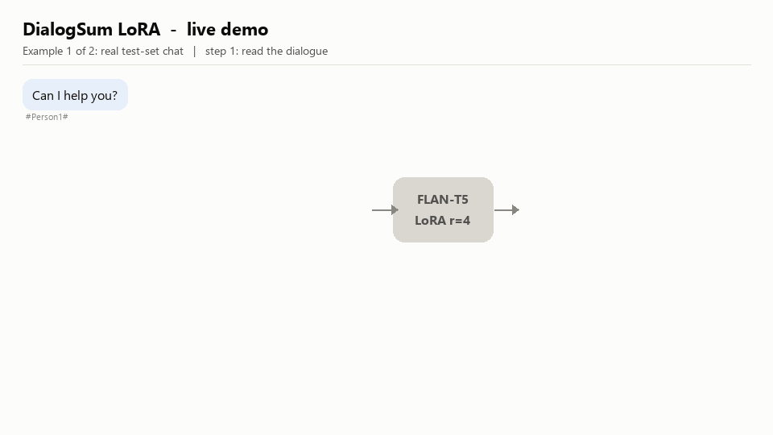

<sub>Two real conversations from the test set, summarized by the fine-tuned model (LoRA r=4).
Not every output is this good. See <a href="#where-the-model-still-makes-mistakes">where the model still makes mistakes</a>.</sub>

</div>

---

## The short version

| | |
|---|---|
| **The problem** | You give the model a chat between two people. It should write a 1-2 sentence summary. |
| **The model** | [`google/flan-t5-small`](https://huggingface.co/google/flan-t5-small), a small (77M parameter) text-to-text model. |
| **The trick** | **LoRA**: freeze the model and train a few tiny add-on layers (**less than 1%** of the weights). |
| **The data** | [DialogSum](https://huggingface.co/datasets/neil-code/dialogsum-test): 1,999 chats for training, 499 for testing. |
| **The result** | ROUGE-1 went from **0.08 → 0.31** (about 4x better). |
| **The hardware** | One laptop GPU (RTX 3060, 6 GB). |

---

## What is this project, in plain words?

Imagine a long chat like this:

> **#Person1#:** Can I help you?
> **#Person2#:** I'd like to buy a new mobile phone please.
> **#Person1#:** Ok, would you like a phone with camera and MP3 player?
> **#Person2#:** Yes please. And I'd like to be able to make video calls too.

We want the computer to read it and write:

> *#Person2# wants to buy a new mobile phone with camera and MP3 player.*

Out of the box, FLAN-T5-small is **bad** at this. It often just copies one line of the chat. So we **fine-tune** it (give it extra practice on 1,999 example chats with human summaries).

Normal fine-tuning changes all 77 million weights, which is slow and needs a lot of memory. Instead we use **LoRA**, which keeps the original model frozen and only trains a tiny "add-on". That is what makes this possible on a laptop.

---

## How it works, step by step

```mermaid
flowchart LR
    A[Load DialogSum<br/>chats + human summaries] --> B[Turn text into tokens<br/>input ≤ 512, summary ≤ 128]
    B --> C[Test the base model<br/>baseline score]
    C --> D[Attach LoRA adapters<br/>to attention layers q and v]
    D --> E[Train 2 epochs<br/>only LoRA weights change]
    E --> F[Save the small adapter]
    F --> G[Summarize 499 test chats]
    G --> H[Score with ROUGE<br/>+ error analysis]
    H --> I[Repeat with rank r=16<br/>and compare]
```

---

## What is LoRA? (the 30-second version)

<picture>
  <source media="(prefers-color-scheme: dark)" srcset="assets/lora_diagram_dark.png">
  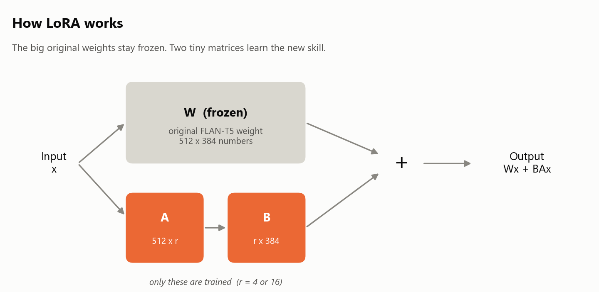
</picture>

- The model's real weight **W** is **frozen**. We never touch it.
- Next to it we add two **tiny** matrices, **A** and **B**. Only these are trained.
- The **rank `r`** is how "wide" A and B are. Bigger `r` means more room to learn, but more weights to train.

How tiny is "tiny"? Look at the bars:

<picture>
  <source media="(prefers-color-scheme: dark)" srcset="assets/trainable_params_dark.png">
  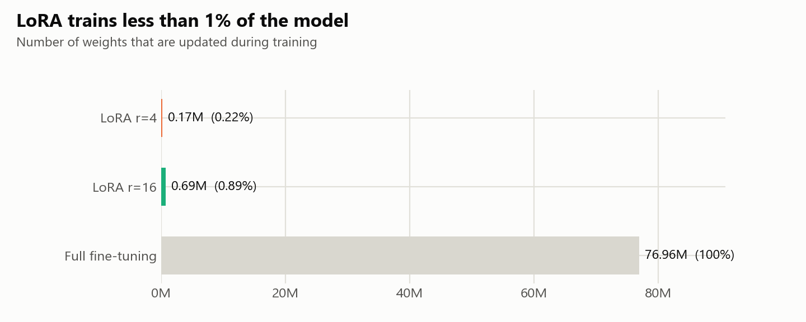
</picture>

With `r=4`, we train only **172,032** weights. That is **0.22%** of the model. The saved adapter is under 1 MB, while the full model is about 300 MB.

---

## Results

### How do we score a summary?

We use **ROUGE**, which measures how many words the model's summary shares with the human's summary.

| Score | What it checks | Simple meaning |
|---|---|---|
| **ROUGE-1** | Single words that match | "Did it use the right words?" |
| **ROUGE-2** | Pairs of words that match | "Did it use the right phrases?" |
| **ROUGE-L** | Longest matching word order | "Does it flow like the human summary?" |

All scores go from **0** (nothing in common) to **1** (identical). Higher is better.

### Before vs after fine-tuning

<div align="center">
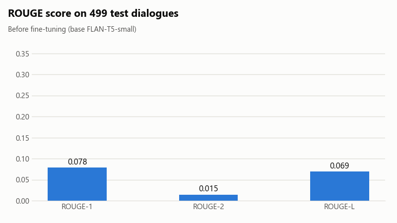
</div>

<picture>
  <source media="(prefers-color-scheme: dark)" srcset="assets/rouge_comparison_dark.png">
  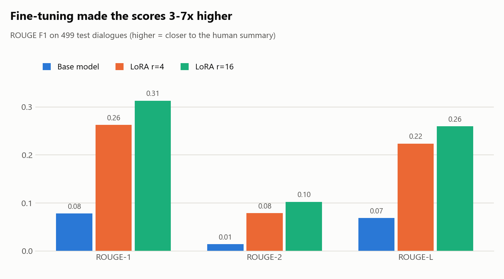
</picture>

| Metric | Base model | LoRA `r=4` | LoRA `r=16` | Gain (base → r=16) |
|---|---:|---:|---:|---:|
| ROUGE-1 | 0.0784 | 0.2625 | **0.3131** | **4.0x** |
| ROUGE-2 | 0.0146 | 0.0788 | **0.1027** | **7.0x** |
| ROUGE-L | 0.0689 | 0.2238 | **0.2599** | **3.8x** |

**What this means:**
- Fine-tuning helped a lot. Every score went up 3-7x.
- The bigger adapter (`r=16`) beat the smaller one (`r=4`) on every score.
- **Caveat:** The `r=16` run also trained for twice as many steps (1,000 vs 500, see *Training settings* below). So part of its win may come from extra training, not only from the higher rank.

### One example, before and after

Same test chat (a boss dictating a memo that bans instant messaging at work):

| Model | Its summary |
|---|---|
| **Human** | *Ms. Dawson helps #Person1# to write a memo to inform every employee that they have to change the communication method and should not use Instant Messaging anymore.* |
| **Base model** | *#Person2#: Thank you for your help.* ← just copies a chat line |
| **LoRA r=16** | *#Person2# asks #Person1# to take a dictation for Ms. Dawson. #Person1# asks #Person2# to take a dictation for Ms. Dawson.* |

The fine-tuned model now writes a summary about the right topic (a dictation). But it **mixes up who is who** and **repeats itself**. These are the two most common mistakes. More on that below.

---

## Training: watching the model learn

<div align="center">
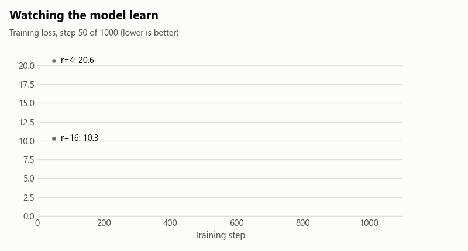
</div>

**Loss** is how "wrong" the model is on the training data. Lower is better. Both runs drop fast in the first ~150 steps, then level off.

<details>
<summary><b>The first attempt crashed. Here is what went wrong and how it was fixed (click to open)</b></summary>
<br>

The first training run used **half precision (FP16)** and a learning rate of `2e-4`. The loss **exploded into the millions**, so the model learned nothing.

<picture>
  <source media="(prefers-color-scheme: dark)" srcset="assets/fp16_vs_fp32_dark.png">
  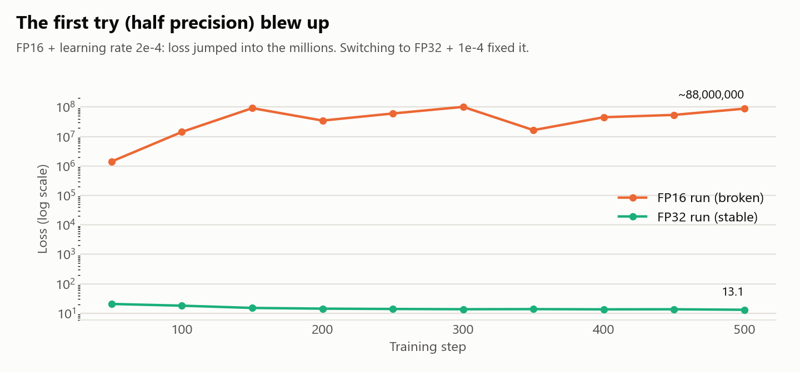
</picture>

**The fix:**
- Switch to full precision (**FP32**). T5 models are known to be unstable in FP16.
- Lower the learning rate to **`1e-4`** and add **50 warm-up steps**.
- Clip gradients (`max_grad_norm=1.0`).

After that, training was stable.
</details>

---

## Where the model still makes mistakes

A good average score does not mean every summary is good. The [`fine_tuned_error_analysis.csv`](fine_tuned_error_analysis.csv) file holds all 499 test predictions from the `r=4` model, and we checked them for obvious problems.

<picture>
  <source media="(prefers-color-scheme: dark)" srcset="assets/error_breakdown_dark.png">
  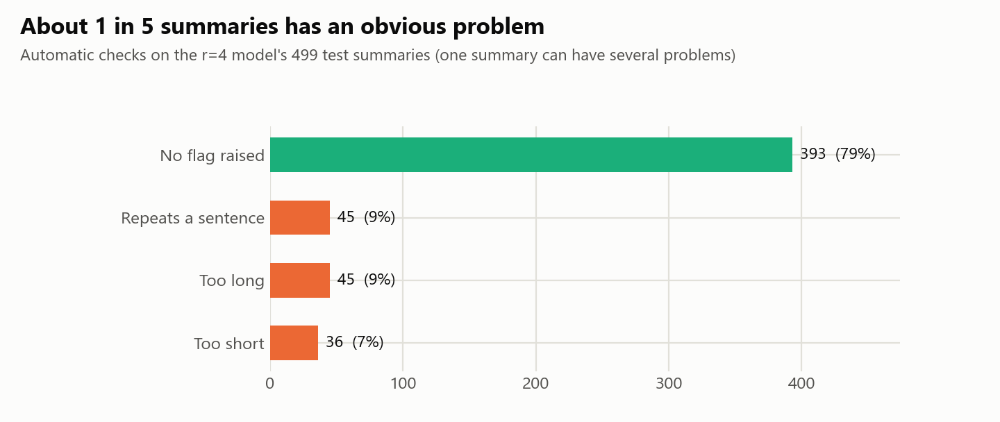
</picture>

### How good is each single summary?

<picture>
  <source media="(prefers-color-scheme: dark)" srcset="assets/rougeL_distribution_dark.png">
  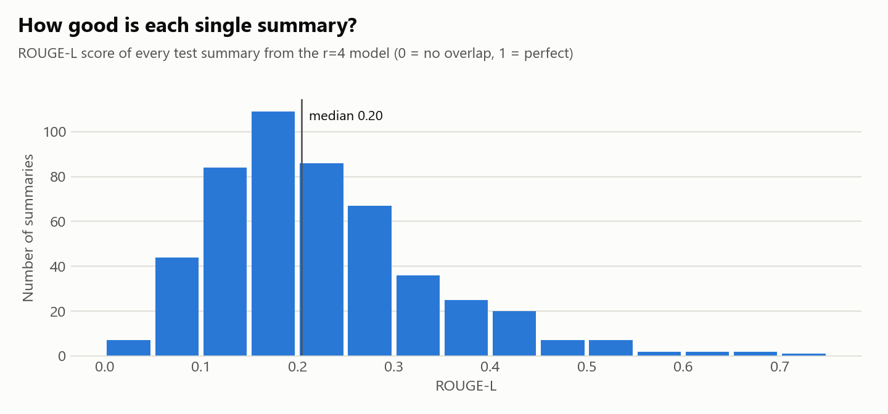
</picture>

Most summaries score between **0.1 and 0.3**. The middle (median) score is **0.20**. A few are very close to the human summary (up to **0.72**), and a few miss completely.

### Does the model write the right length?

<picture>
  <source media="(prefers-color-scheme: dark)" srcset="assets/summary_lengths_dark.png">
  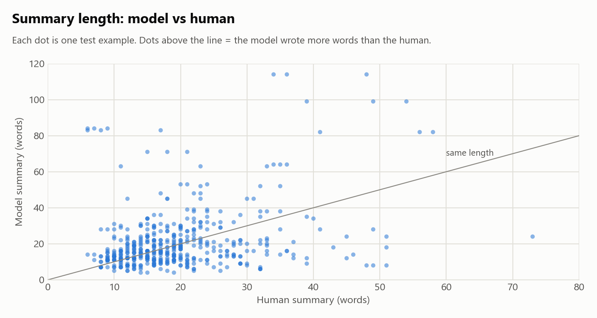
</picture>

On average the lengths match well (model: **21 words**, human: **19 words**). But some summaries **run on to 80-114 words**. These are usually the ones that repeat the same sentence again and again.

### The most common mistakes

| Mistake | Example of what goes wrong |
|---|---|
| **Mixing up speakers** | Says #Person1# did something that #Person2# did. |
| **Repeating itself** | The same sentence 2-3 times in one summary. |
| **Missing the main point** | Summarizes a small detail instead of what the chat was about. |
| **Odd grammar** | Sentences that sound a bit unnatural. |
| **Too literal** | Copies one line from the chat instead of summarizing. |

> **Why are there so many repeated summaries?** Only 166 of the 499 predictions are unique. That sounds bad, but the test set contains each of its **167 conversations about 3 times** (each with a different human summary). The model gives the same summary for the same chat, which is expected. We also checked that **no test chat appears in the training data**.

---

## Training settings

| Setting | LoRA `r=4` | LoRA `r=16` |
|---|---|---|
| Base model | `google/flan-t5-small` | `google/flan-t5-small` |
| LoRA rank `r` | 4 | 16 |
| LoRA alpha | 8 | 32 \* |
| LoRA dropout | 0.1 | 0.05 \* |
| Layers with LoRA | attention `q` and `v` | attention `q` and `v` |
| Trainable weights | 172,032 (0.22%) | ~688,000 (0.89%) |
| Epochs | 2 | 2 |
| Learning rate | `1e-4` (50 warm-up steps) | `1e-4` (50 warm-up steps) \* |
| Batch size × gradient accumulation | 1 × 8 | 1 × 4 |
| Optimizer steps | 500 | 1,000 |
| Precision | FP32 | FP32 |
| Max input / summary length | 512 / 128 tokens | 512 / 128 tokens |
| Last logged training loss | 13.08 | 5.94 |
| Training time | ~24 min | n/a |

<sub>\* The cell that defines the `r=16` settings is not in the saved notebook. These values come from the project's earlier notes. The step count (1,000) is from the recorded training log.</sub>

**Decoding** (how text is generated at test time): greedy, `num_beams=1`, `do_sample=False`, `max_new_tokens=128`. The same settings were used for every model, so the comparison is fair.

---

## Run it yourself

**1. Install the libraries**

```bash
# For an NVIDIA GPU, install the CUDA build of PyTorch first:
pip install torch==2.6.0 --index-url https://download.pytorch.org/whl/cu124

# Then everything else (same versions used for the recorded run):
pip install -r requirements.txt
```

**2. Open the notebook**

```bash
jupyter notebook dialogsum_lora_finetuning.ipynb
```

**3. Run the cells from top to bottom.** The dataset and model download automatically from Hugging Face.

**What you need:**
- An NVIDIA GPU with about **6 GB** of memory (CPU works too, but is much slower)
- At least **16 GB** of RAM
- Python **3.10** or newer

**Rebuild the charts and GIFs in this README:**

```bash
python scripts/make_figures.py
```

---

## What's in this repo

```text
.
├── dialogsum_lora_finetuning.ipynb   ← the full experiment, with all outputs
├── fine_tuned_error_analysis.csv     ← all 499 test predictions + error flags
├── results.md                        ← detailed write-up of the results
├── AI_USE.md                         ← how AI tools were used in this project
├── requirements.txt                  ← exact library versions used
├── scripts/
│   └── make_figures.py               ← builds every chart and GIF below
└── assets/                           ← charts and GIFs used in this README
```

---

## What could make it better

| Idea | Why it might help |
|---|---|
| Use **beam search** instead of greedy decoding | Looks at several possible summaries and picks the best one |
| Add `no_repeat_ngram_size` / repetition penalty | Directly stops the "repeating itself" problem |
| Train longer, with a validation set and early stopping | Find the best checkpoint instead of just the last one |
| Compare `r=4` and `r=16` with the **same number of steps** | Find out how much of the gain is really from the rank |
| Score with the official Hugging Face `evaluate` ROUGE | Makes the numbers comparable with published papers |
| Try more ranks and more layers (`k`, `o`, feed-forward) | See where the adapter helps most |
| Try a bigger model (`flan-t5-base`) | More capacity, if there is enough GPU memory |

---

## Built with

Python · PyTorch · Hugging Face Transformers · Hugging Face Datasets · Hugging Face PEFT · CUDA · NumPy · pandas · Jupyter · Matplotlib

<sub>AI tools were used as a learning and debugging helper during this project. See [AI_USE.md](AI_USE.md) for details.</sub>
